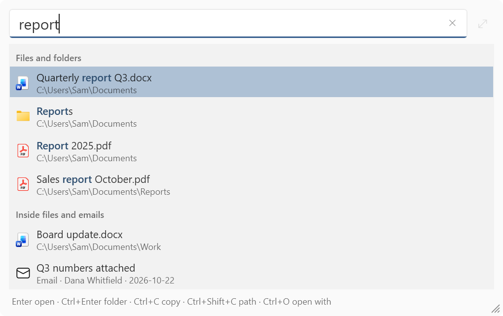

# Findee

Findee finds your files, folders, and apps instantly, as you type – no waiting for a search to complete. It is a fast, keyboard-first finder for Windows 10 and 11: press Alt+Space, type a few letters, and press Enter to open what you found.

<picture><source media="(prefers-color-scheme: dark)" srcset="images/popup-dark.webp"></picture>

**[Download the latest release](https://github.com/markticulous/Findee/releases/latest)** and run `Findee-Setup-<version>.exe`.

The full **User Guide** opens from **Settings → User Guide** inside Findee.

## What it does

- **Finds as you type.** Files and folders on your fixed NTFS drives, and the programs in your Start menu, including Microsoft Store apps, with the results appearing as you type.
- **Learns what you open.** The files, folders, and apps you use most come first, and they are what you see before you type anything.
- **Filters when you want them.** Add `ext:`, `kind:`, `in:`, `size:`, or `modified:` to narrow what you find, alone or together.
- **Acts on the result.** Open it, open its folder, run a program as administrator, copy its path, or drag it into another program. With Peekee installed, Space previews a file.
- **Keeps up with your drives** with a small Windows service that follows every change, so a file you saved a moment ago is already there.
- **Shows each person only what that person can open.** Every user of the PC has their own list.
- **Updates itself**, safely: see below.

## Why Findee is fast

- **It reads the drive's own file table.** Instead of walking through folders one by one, the Findee service reads the table NTFS already keeps of every file, so the first list of a whole drive is quick to make.
- **It follows changes instead of looking again.** NTFS keeps a journal of every change, so the list stays current without scanning the drive a second time.
- **The list is ready before you ask.** The search box searches a list held in memory, so results appear as you type.

Measured on the release candidate (AMD Ryzen 9 5950X, Windows 11, 22 November 2026):

| What | Measured | Limit |
|---|---|---|
| Search box on screen after the shortcut, first time | 79 ms | 100 ms |
| The same, later times | 40 ms | 50 ms |
| One search over a million names | 0.8 ms (slowest test search 4.6 ms) | 15 ms |
| Memory at rest | app 60.5 MB, service 8.2 MB | 80 MB each |
| Processor time at rest, per quiet minute | app 0.6 ms, service 0.1 ms | 10 ms |
| Size on disk (app and service) | 4.2 MB | 10 MB |
| First index of the whole PC (four drives) | 10.1 seconds | |

## Install and updates

Download `Findee-Setup-<version>.exe` from the [latest release](https://github.com/markticulous/Findee/releases/latest) and double-click it. Windows asks once for administrator permission. Findee needs the .NET 10 Desktop Runtime; the setup installs it from Microsoft only if your PC does not have it yet.

Findee is not code-signed yet, so Windows SmartScreen may say "Windows protected your PC". Choose **More info**, then **Run anyway**.

**Updates are checked, not trusted.** Once a day Findee looks at this page for a newer release. Each release carries a small description of itself (its version and the exact size and fingerprint of the installer) signed with a key that only the maintainer holds; the matching public key is built into Findee. Findee installs an update only if the signature is genuine and the download matches the fingerprint. It installs when Findee is not in use, and within 14 days even when automatic updates are turned off. Your settings and history are kept.

**To remove Findee**, use Settings, Apps, Installed apps.

## Privacy and terms

Findee runs on your PC. It does not collect data about you, and has no ads or tracking. Its list of files holds names, folders, sizes, and dates, never what is inside a file, and stays on your PC.

- [Privacy policy](https://markticulous.github.io/support/findee-privacy.html)
- [Terms of use](https://markticulous.github.io/support/site-terms.html)

## Third-party software and trademarks

Findee includes open-source software under its own licences; the full notices are in the `licenses` folder where Findee is installed. Microsoft, Windows, and .NET are trademarks of the Microsoft group of companies. Findee is not affiliated with or endorsed by Microsoft.

## Support Findee

Findee is free and always will be, with no ads and no tracking. If it saves you time, you can [buy me a coffee on Ko-fi](https://ko-fi.com/markticulous) ([why I build these](https://markticulous.github.io/support/?app=findee)). Supporters are thanked in [SUPPORTERS.md](SUPPORTERS.md).

## Feedback

Found a problem or have an idea? [Open an issue](https://github.com/markticulous/Findee/issues).

---

A Markticulous build · © Markticulous
